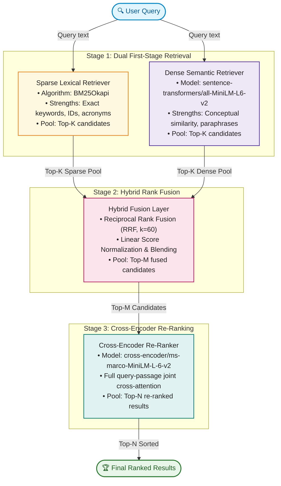

# ⚡ Synapse
### Dual-Stage Hybrid Neural Search & Cross-Encoder Re-Ranking

An end-to-end modern Information Retrieval (IR) system implementing dual-index retrieval (sparse BM25 + dense semantic bi-encoder), rank fusion (Reciprocal Rank Fusion & linear blending), and cross-encoder re-ranking evaluated on an authentic real-world **MS-MARCO** benchmark (sampled from Microsoft Bing search queries and passages).

---

## 🏛️ System Architecture



---

## 📐 Mathematical Formulation

### 1. BM25 Okapi Scoring
$$\text{Score}_{\text{BM25}}(D, Q) = \sum_{q \in Q} \text{IDF}(q) \cdot \frac{f(q, D) \cdot (k_1 + 1)}{f(q, D) + k_1 \cdot \left(1 - b + b \cdot \frac{|D|}{\text{avgdl}}\right)}$$

### 2. Dense Semantic Cosine Similarity
$$\text{Score}_{\text{Dense}}(d, q) = \frac{\mathbf{e}_q \cdot \mathbf{e}_d}{\|\mathbf{e}_q\| \|\mathbf{e}_d\|}$$

### 3. Reciprocal Rank Fusion (RRF)
$$\text{RRF Score}(d) = \sum_{m \in \{\text{BM25}, \text{Dense}\}} \frac{w_m}{k + \text{rank}_m(d)}$$
Where $k=60$ is the standard smoothing constant preventing high-rank domination.

### 4. Evaluation Metrics
- **MRR@K (Mean Reciprocal Rank)**: Measures how early the first relevant passage appears.
- **NDCG@K (Normalized Discounted Cumulative Gain)**: Measures graded relevance with logarithmic rank discounting.
- **Recall@K & Precision@K**: Measures coverage and cleanliness of top results.

---

## 🚀 Quickstart & Setup

### 1. Activate Environment
```powershell
cd C:\..\Neural-IR
python -m venv .venv
.\.venv\Scripts\activate
pip install -r requirements.txt
```

### 2. Run CLI Benchmark & Ablation Study
To run the automated IR benchmark comparing all retrieval stages:
```powershell
python run_eval.py
```

### 3. Launch the Interactive Web Dashboard
To explore queries, view latency profiling, compare rankings, and inspect ground truth matches interactively:
```powershell
streamlit run app.py
```

---
